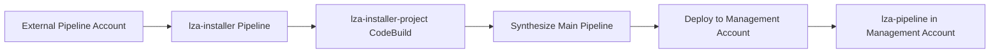

# AcceleratorQualifier Usage Map for External Pipeline Deployments

## Overview

This document maps exactly where the `AcceleratorQualifier` parameter value is used in external pipeline deployments (`useExternalPipelineAccount: true`).

**Source File:** `source/packages/@aws-accelerator/installer/lib/installer-stack.ts`  
**Lines:** 630-658

---

## Usage Summary

The `AcceleratorQualifier` is used as a **prefix/namespace** for resources in the **External Pipeline Account** to enable multiple LZA deployments in a single account without naming conflicts.

### Resources Affected

| Category | Count | Used in Names |
|----------|-------|---------------|
| **S3 Buckets** | 2 | Access Logs, Secure/Installer Bucket |
| **SSM Parameters** | 5 | Stack ID, Version, KMS ARN, Bucket Names, Prefix |
| **CodePipeline** | 2 | Installer Pipeline, Main Pipeline |
| **CodeBuild** | 1 | Installer Project |
| **KMS Key Alias** | 1 | Installer KMS Key |
| **IAM Role** | 1 | Installer Admin Role |
| **IAM Principal ARN** | 1 | Wildcard role pattern for permissions |
| **Environment Variable** | 1 | Passed to CodeBuild |

---

## Detailed Usage Map

### 1. SSM Parameters (External Pipeline Account)

All SSM parameters use the qualifier to create isolated namespaces:

#### Stack Metadata Parameters
```typescript
// Stack ID parameter
`/accelerator/${qualifier}/AWSAccelerator-InstallerStack/stack-id`

// Stack version parameter  
`/accelerator/${qualifier}/AWSAccelerator-InstallerStack/version`
```

**Example with `AcceleratorQualifier: "lza"`:**
```
/accelerator/lza/AWSAccelerator-InstallerStack/stack-id
/accelerator/lza/AWSAccelerator-InstallerStack/version
```

#### Installer Resource Parameters
```typescript
// KMS Key ARN
`/accelerator/${qualifier}/installer/kms/key-arn`

// Access Logs Bucket Name
`/accelerator/${qualifier}/installer-access-logs-bucket-name`
```

**Example with `AcceleratorQualifier: "lza"`:**
```
/accelerator/lza/installer/kms/key-arn
/accelerator/lza/installer-access-logs-bucket-name
```

#### Prefix Validation Parameter
```typescript
// Used by Lambda validation function (from resource-name-prefixes.ts)
`/accelerator/${qualifier}/lza-prefix`
```

**Example with `AcceleratorQualifier: "lza"`:**
```
/accelerator/lza/lza-prefix
```

**Code Reference:** Lines 633-638, 640-642, 646-648

---

### 2. S3 Buckets (External Pipeline Account)

Both installer-related S3 buckets use the qualifier:

#### Access Logs Bucket
```typescript
`${qualifier}-s3-logs-${accountId}-${region}`
```

**Example with `AcceleratorQualifier: "lza"`:**
```
lza-s3-logs-128315352917-eu-central-1
```

**Purpose:** Stores S3 access logs for the installer secure bucket  
**Code Reference:** Lines 643-645

#### Secure/Installer Bucket
```typescript
`${qualifier}-installer-${accountId}-${region}`
```

**Example with `AcceleratorQualifier: "lza"`:**
```
lza-installer-128315352917-eu-central-1
```

**Purpose:** Stores CodePipeline artifacts for the installer pipeline  
**Code Reference:** Lines 649-651

---

### 3. CodePipeline Resources (External Pipeline Account)

#### Installer Pipeline
```typescript
`${qualifier}-installer`
```

**Example with `AcceleratorQualifier: "lza"`:**
```
lza-installer
```

**Purpose:** CodePipeline that deploys the main LZA pipeline stack to the Management Account  
**Code Reference:** Line 654

#### Main Pipeline (Deployed to Management Account)
```typescript
`${qualifier}-pipeline`
```

**Example with `AcceleratorQualifier: "lza"`:**
```
lza-pipeline
```

**Purpose:** Name for the main LZA pipeline that will be deployed in the Management Account  
**Code Reference:** Line 652

---

### 4. CodeBuild Project (External Pipeline Account)

```typescript
`${qualifier}-installer-project`
```

**Example with `AcceleratorQualifier: "lza"`:**
```
lza-installer-project
```

**Purpose:** CodeBuild project used by the installer pipeline to synthesize and deploy the main pipeline  
**Code Reference:** Line 653

---

### 5. KMS Key Alias (External Pipeline Account)

```typescript
`alias/accelerator/${qualifier}/installer/kms/key`
```

**Example with `AcceleratorQualifier: "lza"`:**
```
alias/accelerator/lza/installer/kms/key
```

**Purpose:** KMS key used to encrypt installer S3 buckets and pipeline artifacts  
**Code Reference:** Line 639

---

### 6. IAM Role (External Pipeline Account)

#### Installer Admin Role
```typescript
`${qualifier}-installer-admin-role`
```

**Example with `AcceleratorQualifier: "lza"`:**
```
lza-installer-admin-role
```

**Purpose:** IAM role assumed by CodeBuild to deploy the main pipeline to the Management Account  
**Code Reference:** Line 959

---

### 7. IAM Permission Principal Pattern (External Pipeline Account)

```typescript
`arn:${partition}:iam::${accountId}:role/${qualifier}-*`
```

**Example with `AcceleratorQualifier: "lza"`:**
```
arn:aws:iam::128315352917:role/lza-*
```

**Purpose:** Wildcard principal pattern used in KMS key policies and S3 bucket policies to grant permissions to all qualifier-prefixed roles  
**Code Reference:** Lines 655-657

---

### 8. Environment Variables (Passed to CodeBuild)

The qualifier is passed as an environment variable to the CodeBuild installer project:

```typescript
ACCELERATOR_QUALIFIER: {
  type: BuildEnvironmentVariableType.PLAINTEXT,
  value: this.acceleratorQualifier.valueAsString
}
```

**Purpose:** Used by the installer build script to configure the main pipeline deployment with the correct qualifier  
**Code Reference:** Lines 524-527

**Build Script Usage:** The CodeBuild buildspec uses this environment variable when synthesizing the main pipeline CDK stack.

---

## Comparison: With vs Without AcceleratorQualifier

### Standard Deployment (No Qualifier)

**Scenario:** Pipeline in Management Account, `useExternalPipelineAccount: false`

```
S3 Buckets:
  aws-accelerator-s3-logs-{accountId}-{region}
  
CodePipeline:
  AWSAccelerator-Pipeline
  
SSM Parameters:
  /accelerator/lza-prefix
  /accelerator/AWSAccelerator-InstallerStack/stack-id
```

### External Pipeline Deployment (With Qualifier)

**Scenario:** Pipeline in External Account, `useExternalPipelineAccount: true`, `AcceleratorQualifier: "lza"`

**External Pipeline Account:**
```
S3 Buckets:
  lza-s3-logs-128315352917-eu-central-1
  lza-installer-128315352917-eu-central-1
  
CodePipeline:
  lza-installer
  
CodeBuild Project:
  lza-installer-project
  
IAM Role:
  lza-installer-admin-role
  
KMS Key Alias:
  alias/accelerator/lza/installer/kms/key
  
SSM Parameters:
  /accelerator/lza/lza-prefix
  /accelerator/lza/AWSAccelerator-InstallerStack/stack-id
  /accelerator/lza/AWSAccelerator-InstallerStack/version
  /accelerator/lza/installer/kms/key-arn
  /accelerator/lza/installer-access-logs-bucket-name
```

**Management Account (Deployed by Installer):**
```
CodePipeline:
  lza-pipeline  (controlled by qualifier from external account)
  
All other LZA resources:
  Named using AcceleratorPrefix (e.g., AWSAccelerator-*)
  NOT affected by AcceleratorQualifier
```

---

## Multi-Deployment Scenario

The qualifier enables multiple LZA deployments from a single External Pipeline Account:

### Example: Three LZA Deployments

**Deployment 1:** Production
```yaml
AcceleratorQualifier: "prod"
ManagementAccountId: "111111111111"
```

**Resources in External Pipeline Account:**
```
prod-installer
prod-installer-project
prod-installer-128315352917-eu-central-1 (S3)
prod-s3-logs-128315352917-eu-central-1 (S3)
prod-installer-admin-role (IAM)
/accelerator/prod/* (SSM)
```

---

**Deployment 2:** Development
```yaml
AcceleratorQualifier: "dev"
ManagementAccountId: "222222222222"
```

**Resources in External Pipeline Account:**
```
dev-installer
dev-installer-project
dev-installer-128315352917-eu-central-1 (S3)
dev-s3-logs-128315352917-eu-central-1 (S3)
dev-installer-admin-role (IAM)
/accelerator/dev/* (SSM)
```

---

**Deployment 3:** Sandbox
```yaml
AcceleratorQualifier: "sandbox"
ManagementAccountId: "333333333333"
```

**Resources in External Pipeline Account:**
```
sandbox-installer
sandbox-installer-project
sandbox-installer-128315352917-eu-central-1 (S3)
sandbox-s3-logs-128315352917-eu-central-1 (S3)
sandbox-installer-admin-role (IAM)
/accelerator/sandbox/* (SSM)
```

**Result:** All three deployments coexist in the same External Pipeline Account without naming conflicts.

---

## Resource Isolation

### What IS Isolated (By Qualifier):
✅ Installer resources in **External Pipeline Account**
✅ SSM parameters under `/accelerator/{qualifier}/`
✅ S3 buckets with qualifier prefix
✅ CodePipeline and CodeBuild names
✅ IAM roles with qualifier prefix
✅ KMS key aliases

### What is NOT Isolated (Uses AcceleratorPrefix):
❌ LZA resources in **Management Account** (use `AcceleratorPrefix` instead)
❌ Organizational Units and Accounts
❌ Service Control Policies
❌ AWS Config rules
❌ Security Hub configurations
❌ GuardDuty detectors

---

## Permission Scope

The qualifier affects IAM and KMS permissions in the External Pipeline Account:

### KMS Key Policy Example

The KMS key used for installer encryption grants permissions to:

```json
{
  "Principal": {
    "AWS": "arn:aws:iam::128315352917:role/lza-*"
  }
}
```

This allows all IAM roles starting with `lza-` to use the KMS key, including:
- `lza-installer-admin-role`
- `lza-installer-codebuild-role` (auto-created)
- `lza-installer-codepipeline-role` (auto-created)

### S3 Bucket Policy Example

The S3 secure bucket grants permissions to:

```json
{
  "Principal": {
    "AWS": "arn:aws:iam::128315352917:role/lza-*"
  }
}
```

**Security Implication:** Different qualifiers create isolated permission boundaries. A role with prefix `prod-` cannot access resources for `dev-` qualifier.

---

## Pipeline Flow

### Installer Pipeline Execution Flow



**Key Points:**
1. Installer pipeline runs in **External Pipeline Account** (uses qualifier)
2. Installer project synthesizes the main pipeline CloudFormation template
3. Installer assumes cross-account role in **Management Account**
4. Main pipeline is deployed to **Management Account** (name uses qualifier)
5. Main pipeline deploys LZA resources (names use `AcceleratorPrefix`, not qualifier)

---

## Build Script Usage

The CodeBuild installer project build script uses the `ACCELERATOR_QUALIFIER` environment variable:

**Location:** `source/packages/@aws-accelerator/installer/lib/installer-stack.ts` (buildspec section)

### Build Commands (Simplified)

```bash
# Set external pipeline flag if qualifier is provided
ENABLE_EXTERNAL_PIPELINE_ACCOUNT="no"
if [ ! -z "$MANAGEMENT_ACCOUNT_ID" ] && [ ! -z "$MANAGEMENT_ACCOUNT_ROLE_NAME" ]; then
  ENABLE_EXTERNAL_PIPELINE_ACCOUNT="yes"
fi

# CDK synthesis with context
cd packages/@aws-accelerator/installer

# Use qualifier in synthesis if external pipeline enabled
if [ "$ENABLE_EXTERNAL_PIPELINE_ACCOUNT" = "yes" ]; then
  npx cdk synth \
    --context acceleratorQualifier=$ACCELERATOR_QUALIFIER \
    --context managementAccountId=$MANAGEMENT_ACCOUNT_ID \
    --context managementAccountRoleName=$MANAGEMENT_ACCOUNT_ROLE_NAME \
    --all
fi
```

The qualifier is passed as CDK context to configure the main pipeline stack properly.

---

## Troubleshooting with Qualifier

### Finding Resources for a Specific Qualifier

```bash
QUALIFIER="lza"
REGION="eu-central-1"

# List S3 buckets
aws s3api list-buckets \
  --query "Buckets[?starts_with(Name, '${QUALIFIER}-')].Name" \
  --output table

# List CodePipeline pipelines
aws codepipeline list-pipelines \
  --region ${REGION} \
  --query "pipelines[?starts_with(name, '${QUALIFIER}-')].name" \
  --output table

# List SSM parameters
aws ssm get-parameters-by-path \
  --path "/accelerator/${QUALIFIER}/" \
  --recursive \
  --region ${REGION}

# List IAM roles
aws iam list-roles \
  --query "Roles[?starts_with(RoleName, '${QUALIFIER}-')].RoleName" \
  --output table

# List KMS aliases
aws kms list-aliases \
  --region ${REGION} \
  --query "Aliases[?contains(AliasName, '${QUALIFIER}')].AliasName" \
  --output table
```

### Identifying Which Qualifier Deployed to Which Management Account

```bash
# Get all qualifiers from SSM parameters
for qualifier in $(aws ssm describe-parameters \
  --region eu-central-1 \
  --parameter-filters "Key=Name,Option=BeginsWith,Values=/accelerator/" \
  --query 'Parameters[].Name' \
  --output text | sed 's|/accelerator/||' | cut -d'/' -f1 | sort -u); do
  
  echo "Qualifier: $qualifier"
  
  # Get management account ID from installer pipeline
  aws codepipeline get-pipeline \
    --name "${qualifier}-installer" \
    --region eu-central-1 \
    --query 'pipeline.stages[?name==`Install`].actions[0].configuration.EnvironmentVariables' 2>/dev/null | \
    jq -r '.[] | select(.name=="MANAGEMENT_ACCOUNT_ID") | .value'
  
  echo "---"
done
```

---

## Resource Naming Cheat Sheet

Quick reference for resource names based on `AcceleratorQualifier: "lza"`:

| Resource Type | Naming Pattern | Example |
|---------------|----------------|---------|
| **S3 Buckets** | `{q}-{type}-{acct}-{region}` | `lza-installer-128315352917-eu-central-1` |
| **CodePipeline** | `{q}-{type}` | `lza-installer` |
| **CodeBuild** | `{q}-{type}-project` | `lza-installer-project` |
| **IAM Role** | `{q}-{type}-role` | `lza-installer-admin-role` |
| **KMS Alias** | `alias/accelerator/{q}/{type}/kms/key` | `alias/accelerator/lza/installer/kms/key` |
| **SSM Parameters** | `/accelerator/{q}/{path}` | `/accelerator/lza/lza-prefix` |

Legend: `{q}` = qualifier, `{type}` = resource type, `{acct}` = account ID, `{region}` = region

---

## Related Documentation

- [AcceleratorQualifier Constraints](accelerator-qualifier-constraints.md)
- [LZA Deployment Runbook](deployment-runbook-external-pipeline-s3.md)

---

**Document Owner:** Infrastructure Team  
**Last Updated:** 2026-10-01  
**LZA Version:** 1.15.5+
